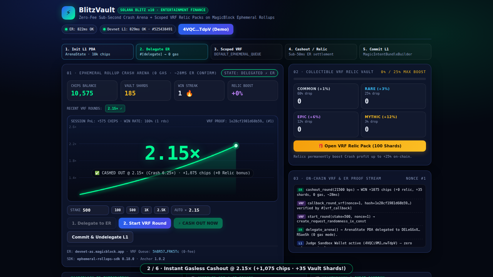

# ⚡ BlitzVault — Real-Time Entertainment Finance on MagicBlock ER

[](https://github.com/AndreyJackKali/blitz-vault/actions/workflows/ci-pages.yml)
[](https://andreyjackkali.github.io/blitz-vault/)
[](https://docs.magicblock.gg/)
[](https://www.anchor-lang.com/)

> **Built for Solana Blitz v10: Entertainment Finance** (Nov 20–27, 2026)  
> Zero-fee, sub-second on-chain **Crash Multiplier Arena** + **Provably Fair VRF Collectible Relic Packs** powered by **MagicBlock Ephemeral Rollups (`ephemeral-rollups-sdk 0.18.0`)** & **Scoped MagicBlock VRF**.

---

## 🎬 Live Demo & HD Walkthrough

- **Play Live Now (Zero Setup / Phantom Devnet + Judge Sandbox):** 👉 **[https://andreyjackkali.github.io/blitz-vault/](https://andreyjackkali.github.io/blitz-vault/)**
- **Watch 48s HD Walkthrough Video:** 👉 **[`docs/demo.mp4`](https://github.com/AndreyJackKali/blitz-vault/raw/main/docs/demo.mp4)** *(also available on [GitHub Releases](https://github.com/AndreyJackKali/blitz-vault/releases))*

[](https://andreyjackkali.github.io/blitz-vault/)

---

## Why Entertainment Finance Needs MagicBlock Ephemeral Rollups

Entertainment Finance merges **real-time speculation** and **collectible asset progression** on state players truly own. Standard Solana L1 execution (400ms slots + gas fees + wallet confirmation popups every move) breaks sub-second crash gameplay.

**BlitzVault** solves this with a 100% on-chain MagicBlock lifecycle:

1. **Initialize on Solana L1 (`initialize_arena`):** Creates the player's canonical `ArenaState` PDA (`[b"blitz_arena_v1", player]`, 151 bytes) with `10,000` starter chips and `150` Vault Shards.
2. **Delegate to MagicBlock ER (`delegate_arena` via `#[delegate]`):** Delegates the `ArenaState` PDA via MagicBlock's Delegation Program ([`DELeGGvXpWV2fqJUhqcF5ZSYMS4JTLjteaAMARRSaeSh`](https://explorer.solana.com/address/DELeGGvXpWV2fqJUhqcF5ZSYMS4JTLjteaAMARRSaeSh?cluster=devnet)) to `devnet-as.magicblock.app` for **0-gas, sub-50ms execution**.
3. **Provably Fair Round Launch (`start_round` + `callback_round_vrf`):** Requests scoped randomness inside the ER via `create_request_randomness_ix_const` on the **fee-exempt `DEFAULT_EPHEMERAL_QUEUE`** ([`5hBR571xnXppuCPveTrctfTU7tJLSN94nq7kv7FRK5Tc`](https://explorer.solana.com/address/5hBR571xnXppuCPveTrctfTU7tJLSN94nq7kv7FRK5Tc?cluster=devnet)), verified by `#[vrf_callback]` to derive a heavy-tail crash multiplier (`1.00×–50.00×`).
4. **Sub-Second Gasless Cashout (`cashout_round`):** Settles profit + permanent Relic yield boost (up to `+25%`) + streak-scaled Vault Shards inside the ER with **0 gas fees**.
5. **VRF Collectible Relic Packs (`open_relic_pack` + `callback_relic_vrf`):** Burns 100 Vault Shards for verifiable Relic drops (`Common 60% +1%`, `Rare 25% +3%`, `Epic 12% +6%`, `Mythic 3% +12%`, capped at `+25%`).
6. **Stale VRF Timeout Recovery (`cancel_stale_vrf`):** 125-second timeout safely refunds stake/shards and advances the round nonce so any delayed oracle callback fails closed.
7. **Atomic L1 Settlement (`commit_arena` & `undelegate_arena`):** Uses SDK `0.18.0`'s non-deprecated `MagicIntentBundleBuilder` to checkpoint or commit-and-undelegate final balances, win streaks, and Relic collections back to Solana L1.

---

## Architecture

```text
Solana Devnet L1                            MagicBlock Ephemeral Rollup (devnet-as)
────────────────                            ───────────────────────────────────────
1. initialize_arena() ──► ArenaState PDA
2. delegate_arena()   ────────────────────► Delegated PDA (0-gas, ~28ms ticks)
   (DELeGGvX…RSaeSh)                         │
                                             ├─► start_round() ──► Scoped VRF (5hBR57…FRK5Tc)
                                             ├─► callback_round_vrf() [#[vrf_callback] verified]
                                             ├─► cashout_round() (instant ER settlement + Relic boost)
                                             ├─► open_relic_pack() ──► callback_relic_vrf() (Common..Mythic)
                                             ├─► cancel_stale_vrf() (125s timeout refund & nonce advance)
                                             │
3. Final L1 State     ◄──────────────────────┴─ undelegate_arena() [MagicIntentBundleBuilder]
```

---

## Verification, CI Proofs & On-Chain Status

| Check | Status | Details / Links |
|---|---|---|
| **Solana SBF ELF Binary (`blitz_vault.so`)** | ✅ Built in CI | 351 KB `ELF 64-bit eBPF` built via Agave `cargo-build-sbf` ([Download CI Artifact](https://github.com/AndreyJackKali/blitz-vault/actions)) |
| **Extended Rust Unit & Invariant Suite** | ✅ 14 / 14 Passing | Crash curve bounds & 5k Monte Carlo distribution, VRF domain separation, Relic boost caps/overflow, payout solvency, Borsh `INIT_SPACE`, MagicBlock ER/VRF PDAs & instruction layouts |
| **Real `solana-test-validator` SBF E2E** | ✅ 7 / 7 On-Chain Assertions | Loads compiled `blitz_vault.so` into Solana BPF VM (`solana-core 4.4.1`), executes real `initialize_arena`, verifies 151-byte on-chain `ArenaState` PDA, and proves all security error guards (`0x1775`, `0x1779`, `0x1772`, `0x1777`, unauthorized intruder rejection) |
| **Live Interactive Web Arena** | ✅ Live HTTPS | [andreyjackkali.github.io/blitz-vault](https://andreyjackkali.github.io/blitz-vault/) with live MagicBlock Devnet ER (`devnet-as.magicblock.app`) & Solana Devnet L1 RPC health probes |
| **MagicBlock Devnet Infrastructure** | ✅ Verified Live | Delegation Program [`DELeGGvX…RSaeSh`](https://explorer.solana.com/address/DELeGGvXpWV2fqJUhqcF5ZSYMS4JTLjteaAMARRSaeSh?cluster=devnet) · Ephemeral VRF Queue [`5hBR57…FRK5Tc`](https://explorer.solana.com/address/5hBR571xnXppuCPveTrctfTU7tJLSN94nq7kv7FRK5Tc?cluster=devnet) |
| **Solana Devnet Deploy Readiness** | ⚠️ Faucet Gated | Public `api.devnet.solana.com` `requestAirdrop` currently returns JSON-RPC `410` (*"The RPC faucet is closed on this cluster. Request test SOL at https://faucet.solana.com"*), and MagicBlock Devnet RPCs have free faucet disabled (`-32600`). Ready for 1-command deploy below once funded with 2 Devnet SOL from `faucet.solana.com`. |

---

## 1-Command Build, Test & Devnet Deploy

```bash
# 1. Run all 14 Rust unit & MagicBlock layout tests
cargo test --manifest-path programs/blitz-vault/Cargo.toml --lib -- --nocapture

# 2. Build the Solana SBF binary (target/deploy/blitz_vault.so)
cargo-build-sbf --manifest-path programs/blitz-vault/Cargo.toml --sbf-out-dir target/deploy

# 3. Run real localnet SBF E2E test against compiled blitz_vault.so
solana-test-validator --reset --quiet \
  --bpf-program BLzVt11111111111111111111111111111111111111 target/deploy/blitz_vault.so &
node scripts/e2e_localnet.mjs

# 4. Deploy to Solana Devnet (after funding wallet with 2 SOL from https://faucet.solana.com)
solana program deploy target/deploy/blitz_vault.so --url devnet
```

---

## Technical Highlights (Nov 2026 MagicBlock Best Practices)
- **SDK `0.18.0` + Anchor `1.0.2`:** Compatible with both validator 1.x and 2.0 public ERs (avoids `0.20.0` `slot_hashes` VRF breakage).
- **Scoped VRF Security:** Compile-time `PROGRAM_IDENTITY = program_identity_pubkey(&crate::ID)` + `#[vrf_callback]` prevents spoofed oracle calls.
- **Strict Nonce State Machine:** `Idle → AwaitingVrf(nonce) → Live → Idle` with `cancel_stale_vrf()` (>125s TTL) advancing the nonce so late callbacks fail closed.
- **Zero Deprecated APIs:** Uses `MagicIntentBundleBuilder` and `UncheckedAccount` with `del` constraint (SIMD-0460 safe).
- **Exact Rust ↔ Frontend Parity:** Both `programs/blitz-vault/src/lib.rs` and `web/index.html` implement identical `derive_crash_point_bps(&[u8; 32])` fixed-point basis-point arithmetic.
