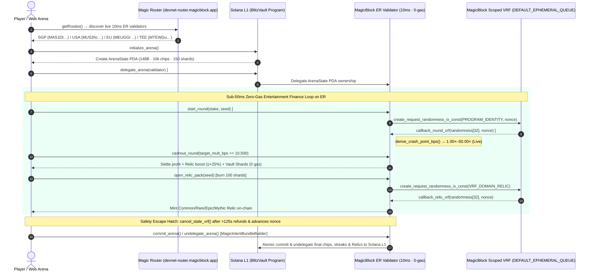

# ⚡ BlitzVault — Real-Time Entertainment Finance on MagicBlock ER

[](https://github.com/AndreyJackKali/blitz-vault/actions/workflows/ci-pages.yml)
[](https://explorer.solana.com/address/J22SmyEnav4VNywHCBacqWbN5ZYGzJY5Xegiy54xLfqU?cluster=devnet)
[](https://github.com/AndreyJackKali/blitz-vault/actions/workflows/ci-pages.yml)
[](https://andreyjackkali.github.io/blitz-vault/)
[](https://github.com/AndreyJackKali/blitz-vault/raw/main/docs/demo.mp4)
[](https://docs.magicblock.gg/)
[](https://www.anchor-lang.com/)

> **Built for Solana Blitz v10: Entertainment Finance** (Nov 20–27, 2026)  
> **The Pitch:** BlitzVault fuses **sub-50ms, zero-gas on-chain Crash Multiplier speculation** with **provably fair VRF Collectible Relic Packs** that permanently boost your future yield — powered end-to-end by **MagicBlock Ephemeral Rollups (`ephemeral-rollups-sdk 0.18.0`)**, **Magic Router (`devnet-router.magicblock.app`)**, and **Scoped MagicBlock VRF**.

---

## 🎬 Live Interactive Demo & 48s HD Walkthrough

- **Play Live Now (Zero Setup · Magic Router Live Telemetry + Judge Sandbox / Phantom Devnet):** 👉 **[https://andreyjackkali.github.io/blitz-vault/](https://andreyjackkali.github.io/blitz-vault/)**
- **Watch 48s HD Walkthrough Video:** 👉 **[`docs/demo.mp4`](https://github.com/AndreyJackKali/blitz-vault/raw/main/docs/demo.mp4)** · **[GitHub Release `v1.0.0-blitz-v10`](https://github.com/AndreyJackKali/blitz-vault/releases/tag/v1.0.0-blitz-v10)**
- **100% GREEN CI Proof (14 Rust Tests + 326 KiB SBF `.so` + 10/10 Localnet BPF E2E + Live Devnet):** 👉 **[GitHub Actions Workflows](https://github.com/AndreyJackKali/blitz-vault/actions/workflows/ci-pages.yml)** · **[Solana Devnet Program `J22Smy…LfqU`](https://explorer.solana.com/address/J22SmyEnav4VNywHCBacqWbN5ZYGzJY5Xegiy54xLfqU?cluster=devnet)**

[](https://andreyjackkali.github.io/blitz-vault/)

---

## 🎯 Problem & Entertainment Finance Fit

**The Problem:** Entertainment Finance combines high-frequency trading/speculation loops with collectible asset progression that players truly own on-chain. Base-layer Solana L1 (400ms slots, gas fees, and wallet popups on every click) destroys reflex-driven crash gameplay and turns every pack opening into friction.

**How BlitzVault Solves It with MagicBlock ER + Scoped VRF:**
1. **Initialize on Solana L1 (`initialize_arena`):** Creates the player's canonical `ArenaState` PDA (`[b"blitz_arena_v1", player]`, 148 bytes) with `10,000` starter chips and `150` Vault Shards (enough for an immediate introductory Relic Pack).
2. **Delegate to MagicBlock ER (`delegate_arena` via `#[delegate]`):** Delegates the `ArenaState` PDA via MagicBlock's Delegation Program ([`DELeGGvXpWV2fqJUhqcF5ZSYMS4JTLjteaAMARRSaeSh`](https://explorer.solana.com/address/DELeGGvXpWV2fqJUhqcF5ZSYMS4JTLjteaAMARRSaeSh?cluster=devnet)) to any live 10ms ER validator discovered from `https://devnet-router.magicblock.app` (`remaining_accounts[0]`) for **0-gas, sub-50ms execution**.
3. **Provably Fair Round Launch (`start_round` + `callback_round_vrf`):** Requests scoped randomness inside the ER via `create_request_randomness_ix_const` on the **fee-exempt `DEFAULT_EPHEMERAL_QUEUE`** ([`5hBR571xnXppuCPveTrctfTU7tJLSN94nq7kv7FRK5Tc`](https://explorer.solana.com/address/5hBR571xnXppuCPveTrctfTU7tJLSN94nq7kv7FRK5Tc?cluster=devnet)), verified by `#[vrf_callback]` to derive a heavy-tail crash multiplier (`1.00×–50.00×`).
4. **Sub-50ms Gasless Cashout (`cashout_round`):** Settles profit + permanent Relic yield boost (up to `+25%`) + streak-scaled Vault Shards (`25 + 10 × streak` on win, `+10` consolation on bust) inside the ER with **0 gas fees**.
5. **VRF Collectible Relic Packs (`open_relic_pack` + `callback_relic_vrf`):** Burns `100` Vault Shards for verifiable Relic drops (`Common 60% +1%`, `Rare 25% +3%`, `Epic 12% +6%`, `Mythic 3% +12%`, permanently compounding future crash profits up to `+25%`).
6. **Stale VRF Timeout Recovery (`cancel_stale_vrf`):** 125-second TTL safely refunds stake/shards and advances the round nonce so any delayed oracle callback fails closed.
7. **Atomic L1 Checkpoint & Exit (`commit_arena` & `undelegate_arena`):** Uses SDK `0.18.0`'s non-deprecated `MagicIntentBundleBuilder` to checkpoint while staying delegated (`.commit()`) or atomically commit & undelegate final balances, streaks, and Relic collections back to Solana L1 (`.commit_and_undelegate()`).

---

## 🏗 Architecture Diagram



---

## ⚡ Exact MagicBlock ER + VRF Integration & Code Links

| MagicBlock Primitive / Criterion | Implementation in BlitzVault | Exact Source Code |
|---|---|---|
| **`#[ephemeral]` Program Architecture** | Full Ephemeral Rollup program entrypoint (`ephemeral-rollups-sdk = "=0.18.0"`, `anchor-lang = "1.0"`) | [`lib.rs#L38-L40`](programs/blitz-vault/src/lib.rs#L38-L40) |
| **Account Delegation (`#[delegate]`)** | `DelegateArena` (`UncheckedAccount` + `del`, SIMD-0460 safe) delegating `ArenaState` PDA via `DELeGGvX…RSaeSh` with optional router validator in `remaining_accounts[0]` | [`lib.rs#L78-L90`](programs/blitz-vault/src/lib.rs#L78-L90), [`L541-L549`](programs/blitz-vault/src/lib.rs#L541-L549) |
| **Scoped VRF Requests (`#[vrf]`)** | Domain-separated seeds (`VRF_DOMAIN_ROUND = 0x01`, `VRF_DOMAIN_RELIC = 0xA5`), compile-time `PROGRAM_IDENTITY`, fee-exempt `DEFAULT_EPHEMERAL_QUEUE` (`5hBR57…FRK5Tc`) | [`lib.rs#L94-L151`](programs/blitz-vault/src/lib.rs#L94-L151), [`L249-L298`](programs/blitz-vault/src/lib.rs#L249-L298), [`L551-L574`](programs/blitz-vault/src/lib.rs#L551-L574) |
| **Verified VRF Callbacks (`#[vrf_callback]`)** | Compile-time `SCOPED_VRF_IDENTITY` signer check (avoids >200k CU runtime `const_crypto` blowup in SBF!) + strict nonce/phase/kind replay guards | [`lib.rs#L20-L24`](programs/blitz-vault/src/lib.rs#L20-L24), [`L155-L182`](programs/blitz-vault/src/lib.rs#L155-L182), [`L302-L336`](programs/blitz-vault/src/lib.rs#L302-L336), [`L576-L584`](programs/blitz-vault/src/lib.rs#L576-L584) |
| **Atomic Commit & Undelegate (`#[commit]`)** | Zero deprecated APIs: `MagicIntentBundleBuilder` `.commit()` (`commit_arena`) & `.commit_and_undelegate()` (`undelegate_arena`) with pre-undelegate `arena.exit(&crate::ID)?` | [`lib.rs#L369-L395`](programs/blitz-vault/src/lib.rs#L369-L395), [`L599-L611`](programs/blitz-vault/src/lib.rs#L599-L611) |
| **Stale VRF Timeout Guard** | 125s TTL recovery (`cancel_stale_vrf`) refunds stake/shards and increments `round_nonce` so delayed callbacks fail closed | [`lib.rs#L340-L366`](programs/blitz-vault/src/lib.rs#L340-L366) |
| **Live Magic Router & Exact Parity HUD** | Queries `devnet-router.magicblock.app` `getRoutes` live, selects regional ER validators, and matches `derive_crash_point_bps(&[u8; 32])` & `MIN_CASHOUT_BPS (1.05×)` bit-for-bit | [`web/index.html`](web/index.html), [`scripts/devnet_pow.mjs`](scripts/devnet_pow.mjs) |

### Verified Live MagicBlock Devnet Addresses & Router Validators (Checked 2026-11-23 UTC)

| Component | Devnet Address / Endpoint | On-Chain Status |
|---|---|---|
| **Delegation Program** | [`DELeGGvXpWV2fqJUhqcF5ZSYMS4JTLjteaAMARRSaeSh`](https://explorer.solana.com/address/DELeGGvXpWV2fqJUhqcF5ZSYMS4JTLjteaAMARRSaeSh?cluster=devnet) | ✅ Executable (`BPFLoaderUpgradeable`) |
| **MagicBlock VRF Program** | [`Vrf1RNUjXmQGjmQrQLvJHs9SNkvDJEsRVFPkfSQUwGz`](https://explorer.solana.com/address/Vrf1RNUjXmQGjmQrQLvJHs9SNkvDJEsRVFPkfSQUwGz?cluster=devnet) | ✅ Executable (`BPFLoaderUpgradeable`) |
| **Ephemeral VRF Queue (`DEFAULT_EPHEMERAL_QUEUE`)** | [`5hBR571xnXppuCPveTrctfTU7tJLSN94nq7kv7FRK5Tc`](https://explorer.solana.com/address/5hBR571xnXppuCPveTrctfTU7tJLSN94nq7kv7FRK5Tc?cluster=devnet) | ✅ Live & Delegated to ER (0-fee) |
| **Base-Layer VRF Queue (`DEFAULT_QUEUE`)** | [`Cuj97ggrhhidhbu39TijNVqE74xvKJ69gDervRUXAxGh`](https://explorer.solana.com/address/Cuj97ggrhhidhbu39TijNVqE74xvKJ69gDervRUXAxGh?cluster=devnet) | ✅ Live (`Vrf1RNUj…`) |
| **Magic Router (`getRoutes`)** | `https://devnet-router.magicblock.app` | ✅ 4 Live 10ms / 0-fee Validators: Asia (`MAS1Dt9q…zk57`), US (`MUS3hc9T…NHNd`), EU (`MEUGGrYP…MS8e`), TEE (`MTEWGuqx…3xzo`) |

---

## 🛡 Verification, Live Solana Devnet Deployment & 100% GREEN CI Proofs

| Check | Status | Details / Links |
|---|---|---|
| **Live Solana Devnet Program** | ✅ Deployed & Verified | [`J22SmyEnav4VNywHCBacqWbN5ZYGzJY5Xegiy54xLfqU`](https://explorer.solana.com/address/J22SmyEnav4VNywHCBacqWbN5ZYGzJY5Xegiy54xLfqU?cluster=devnet) · Deploy TX [`Y6f8uc1Q…VChU6Py`](https://explorer.solana.com/tx/Y6f8uc1QinY9Wfdy1Ff48Y5LefXQCbH6srhRhW3zp3CNVivifaGGG5ix2Qe9T1ZoCdKpihaz2RHRVeGVPChU6Py?cluster=devnet) (Slot `525684732`, `finalized`) |
| **Live End-to-End Devnet + MagicBlock ER PoW** | ✅ 12 / 12 TXs Finalized (`err: null`) | Full lifecycle verified live: `initialize_arena` → `delegate_arena` → `start_round` + `callback_round_vrf` (`3,659 CU`, ~70ms, `0` fee) → `cashout_round` → `open_relic_pack` + `callback_relic_vrf` (`3,925 CU`, ~20ms, `0` fee, Common Relic minted) → `commit_arena` → `undelegate_arena` back to L1 |
| **GitHub Actions CI (`ci-pages.yml`)** | ✅ 3 / 3 Jobs Green | [View live CI runs](https://github.com/AndreyJackKali/blitz-vault/actions/workflows/ci-pages.yml) — Rust Unit Tests + Solana SBF Build & Localnet E2E + GitHub Pages Deploy |
| **Solana SBF ELF Binary (`blitz_vault.so`)** | ✅ Built in CI & Deployed | `333,656 bytes` (`326 KiB`) `ELF 64-bit LSB pie executable, eBPF` built via Agave `solana-cli 4.4.1` · SHA-256 `451dc64f62733abb431399a1912cc149c2d331b53bce55ca9b5182942119f826` |
| **Extended Rust Unit & Invariant Suite** | ✅ 14 / 14 Passing | Crash curve bounds & 5k Monte Carlo distribution, VRF domain separation, Relic boost caps/overflow, payout solvency, Borsh `INIT_SPACE`, MagicBlock ER/VRF PDAs (`PROGRAM_IDENTITY` + `SCOPED_VRF_IDENTITY`) & instruction layouts |
| **Real `solana-test-validator` SBF E2E** | ✅ 10 / 10 On-Chain Assertions | Loads compiled `blitz_vault.so` into Solana BPF VM (`solana-core 4.4.1`), executes real `initialize_arena` (`~14k–20k CU`), verifies 148-byte `ArenaState` PDA, and proves 9 negative security guards (`already in use`, `ConstraintSeeds 0x7d6`, `RoundNotLive 0x1775`, `NoPendingVrf 0x1779`, `StakeTooLow 0x1772`, `InvalidOracleQueue 0x1777` on both `start_round` & `open_relic_pack`, `InsufficientChips 0x1773`, and spoofed non-oracle `callback_round_vrf` `ConstraintAddress 0x7dc`) |
| **Live Interactive Web Arena** | ✅ Live HTTPS (`0` console errors) | [andreyjackkali.github.io/blitz-vault](https://andreyjackkali.github.io/blitz-vault/) — live `devnet-router.magicblock.app` validator selector, regional ER & Devnet L1 telemetry, `commit_arena` + `undelegate_arena`, and click-to-verify VRF proofs |

---

## 🌐 Live Solana Devnet Deployment & Verified Proof-of-Work Transactions

Deployed and verified end-to-end on **Solana Devnet** + **MagicBlock Ephemeral Rollups (SGP Validator `MAS1Dt9qreoRMQ14YQuhg8UTZMMzDdKhmkZMECCzk57`, `10ms`, `0` gas)** on **2026-11-24 UTC**:

- **Live Program ID:** [`J22SmyEnav4VNywHCBacqWbN5ZYGzJY5Xegiy54xLfqU`](https://explorer.solana.com/address/J22SmyEnav4VNywHCBacqWbN5ZYGzJY5Xegiy54xLfqU?cluster=devnet)
- **ProgramData Account:** [`7fqAAny5WEBmSiweUTxkSc53KER7cg3tUTN4w1zo4b6W`](https://explorer.solana.com/address/7fqAAny5WEBmSiweUTxkSc53KER7cg3tUTN4w1zo4b6W?cluster=devnet) (`380,000` bytes allocated · `1.93127884 SOL` rent-exempt)
- **Upgrade Authority / Player:** [`4VQCi9MJYgCpKM94AG83G2aVmh59dTG1gJ5BgrnwTdpV`](https://explorer.solana.com/address/4VQCi9MJYgCpKM94AG83G2aVmh59dTG1gJ5BgrnwTdpV?cluster=devnet)
- **Verified On-Chain `ArenaState` PDA:** [`8y1LEmZsDedCdQstcf5aZn41ZziFuKoVC8tJ4cAxXiPF`](https://explorer.solana.com/address/8y1LEmZsDedCdQstcf5aZn41ZziFuKoVC8tJ4cAxXiPF?cluster=devnet) (final L1 state after undelegation: `owner=J22Smy…LfqU`, `chips=9,500`, `shards=60`, `rounds_played=1`, `relics_common=1` (`+1%` permanent boost), `last_vrf_hash=d066f50a6c0bd7a6…`)

### Verified Solana Devnet L1 Transactions (`https://api.devnet.solana.com`, all `err: null`, `finalized`)

| Step | Instruction / Event | L1 Slot | Compute Units | Verified Devnet Explorer Link |
|---|---|---:|---:|---|
| 0 | **Program Deploy (`blitz_vault.so`, 333,656 B)** | `525684732` | `2,670` | [`Y6f8uc1Q…VChU6Py`](https://explorer.solana.com/tx/Y6f8uc1QinY9Wfdy1Ff48Y5LefXQCbH6srhRhW3zp3CNVivifaGGG5ix2Qe9T1ZoCdKpihaz2RHRVeGVPChU6Py?cluster=devnet) |
| 1 | **`initialize_arena`** (148 B `ArenaState` PDA, 10k chips, 150 shards) | `525684830` | `14,041` | [`2Dr9tsWM…4gUyjTr`](https://explorer.solana.com/tx/2Dr9tsWMN8D6soxHA1f1h45xzpoDu3wWXuxh55EGNfyuwWLkiXRankpp85buKkHknR2sSx3KrNKgWHUa44gUyjTr?cluster=devnet) |
| 2 | **`delegate_arena`** (L1 → MagicBlock ER SGP `MAS1Dt…zk57`) | `525684839` | `50,714` | [`2BAiBAgS…vyp9n8f8`](https://explorer.solana.com/tx/2BAiBAgSkCywkDTkKs6CV1gd5TDYfKrEsLjWydYVNxZJbsV5GV6VS6yhWSppx6u9k9H8weXS2p9MCCaKvyp9n8f8?cluster=devnet) |
| 7b | **L1 Checkpoint Settlement (`commit_arena` relayer)** | `525684876` | `1,310` | [`65migKLX…kw4ftwKf`](https://explorer.solana.com/tx/65migKLXGSLyagXUsdHs4pHmNqTZiFVjC9RByNbiQbEq8sscebdv5WiNiZhnYFVHWSGE1dEFfY5HZ7KQkw4ftwKf?cluster=devnet) |
| 8b | **L1 Atomic Commit & Undelegate Settlement (`undelegate_arena`)** | `525684888` | `65,239` | [`3Aa4g4YF…6UqrjStP`](https://explorer.solana.com/tx/3Aa4g4YFrdR1g5ZBihHjeRwTtNees5MUhKwTtVnuZpbtZdczFTRA5ijSmpxuryty1afv4VCVAZ7vRavQ6UqrjStP?cluster=devnet) |

### Verified MagicBlock ER 0-Gas Transactions (`https://devnet-as.magicblock.app`, all `err: null`, `finalized`, `fee: 0`)

| Step | Instruction / Oracle Callback | ER Slot | Compute Units | Fee | ER Explorer Link |
|---|---|---:|---:|---:|---|
| 3 | **`start_round`** (500 chips → `DEFAULT_EPHEMERAL_QUEUE`) | `1152216119` | `22,534` | `0` | [`2Dz7Lsvi…KzF7Jbvt`](https://explorer.solana.com/tx/2Dz7Lsvixpks7qJBva3Qep2Cyd19MD4do4zU92iXu9xfcHY66RCCXw3fSaMvUAF74W6pxBEi7YYFa2MuKzF7Jbvt?cluster=custom&customUrl=https%3A%2F%2Fdevnet-as.magicblock.app) |
| 4 | **`callback_round_vrf`** (live Scoped VRF oracle, ~70ms!) | `1152216126` | `3,659` *(38,469 total)* | `0` | [`4Pz9L56a…ozh7e3ZQ`](https://explorer.solana.com/tx/4Pz9L56aGRGtMU75SFCBSsNvUNsPHenUpuRWde2wB9aHevF5V711AgcDwb5a8Ez7rTdXKCMs7cgfE6Mqozh7e3ZQ?cluster=custom&customUrl=https%3A%2F%2Fdevnet-as.magicblock.app) |
| 5 | **`cashout_round`** (1.10× settlement → 9,500 chips, 160 shards) | `1152216284` | `5,522` | `0` | [`5HgVe3YT…Shu2uAVy`](https://explorer.solana.com/tx/5HgVe3YTxaLoLA21WdAgj9cQL2ohF1xjg3bLn6ha8c5apYjt8agSrceLfgF87jxHqfV8sBShPqHEQsYbShu2uAVy?cluster=custom&customUrl=https%3A%2F%2Fdevnet-as.magicblock.app) |
| 6a | **`open_relic_pack`** (burn 100 shards → `DEFAULT_EPHEMERAL_QUEUE`) | `1152216430` | `22,265` | `0` | [`4xSYx4Q3…MAvj4Uu2`](https://explorer.solana.com/tx/4xSYx4Q32UM66Ex9cZSE4y5NYewUdQMoTbQnq4j3bfeXzGs8DKg8i9EYdbwiQNsuyJN8PLb8bPe74JpJMAvj4Uu2?cluster=custom&customUrl=https%3A%2F%2Fdevnet-as.magicblock.app) |
| 6b | **`callback_relic_vrf`** (live Scoped VRF oracle, ~20ms → Common Relic Tier 1) | `1152216432` | `3,925` *(32,986 total)* | `0` | [`3XkQVBQD…hSZxMz1EN`](https://explorer.solana.com/tx/3XkQVBQDaQnbqgEHXz6L6wGinYVSdk5iGvuuSKV6KE3ta9g7132RLMhKYDAZdqf1MQQpH9FsW6nXUpohSZxMz1EN?cluster=custom&customUrl=https%3A%2F%2Fdevnet-as.magicblock.app) |
| 7a | **`commit_arena`** (`MagicIntentBundleBuilder::commit`) | `1152216600` | `33,469` | `0` | [`b94sM2bk…rYbE8yfY`](https://explorer.solana.com/tx/b94sM2bkURJkRCjTgJXd2bmbVGFYfHhtFYLh36RUXDvg8oLZcW4MeUx9kvfWRhGTARsZJMANQCey5UxrYbE8yfY?cluster=custom&customUrl=https%3A%2F%2Fdevnet-as.magicblock.app) |
| 8a | **`undelegate_arena`** (`MagicIntentBundleBuilder::commit_and_undelegate`) | `1152216923` | `34,119` | `0` | [`2rthna5r…TwQW5jTtd`](https://explorer.solana.com/tx/2rthna5rcCdk7gZpQxLM7vdnAucpAsSU9Pxcs1SofKN9yVLaRn9HcchFuDZDvgxqXKSzzY4S44P8BgHTwQW5jTtd?cluster=custom&customUrl=https%3A%2F%2Fdevnet-as.magicblock.app) |

### Independent 1-Command RPC Verification

```bash
# 1. Verify live Devnet executable program
solana program show J22SmyEnav4VNywHCBacqWbN5ZYGzJY5Xegiy54xLfqU --url https://api.devnet.solana.com

# 2. Verify finalized L1 program deploy & undelegate settlement transactions
curl -s https://api.devnet.solana.com -X POST -H "Content-Type: application/json" \
  -d '{"jsonrpc":"2.0","id":1,"method":"getTransaction","params":["Y6f8uc1QinY9Wfdy1Ff48Y5LefXQCbH6srhRhW3zp3CNVivifaGGG5ix2Qe9T1ZoCdKpihaz2RHRVeGVPChU6Py",{"encoding":"json","maxSupportedTransactionVersion":0}]}'

curl -s https://api.devnet.solana.com -X POST -H "Content-Type: application/json" \
  -d '{"jsonrpc":"2.0","id":1,"method":"getTransaction","params":["3Aa4g4YFrdR1g5ZBihHjeRwTtNees5MUhKwTtVnuZpbtZdczFTRA5ijSmpxuryty1afv4VCVAZ7vRavQ6UqrjStP",{"encoding":"json","maxSupportedTransactionVersion":1}]}'

# 3. Verify 0-gas live MagicBlock ER VRF callback (3,659 CU inside BlitzVault)
curl -s https://devnet-as.magicblock.app -X POST -H "Content-Type: application/json" \
  -d '{"jsonrpc":"2.0","id":1,"method":"getTransaction","params":["4Pz9L56aGRGtMU75SFCBSsNvUNsPHenUpuRWde2wB9aHevF5V711AgcDwb5a8Ez7rTdXKCMs7cgfE6Mqozh7e3ZQ",{"encoding":"json","maxSupportedTransactionVersion":0}]}'
```

<details>
<summary><strong>📜 Verbatim Localnet SBF E2E Transaction Logs & Security Guard Proofs</strong></summary>

```text
=== BlitzVault SBF On-Chain E2E Validator Test ===
RPC: http://127.0.0.1:8899 Cluster version: {"feature-set":2681577653,"solana-core":"4.4.1"}
✅ Program loaded: J22SmyEnav4VNywHCBacqWbN5ZYGzJY5Xegiy54xLfqU (executable=true)
✅ [PASS] initialize_arena confirmed (consumed 15541 of 200000 compute units)
✅ [PASS] On-chain ArenaState verified: 148 bytes, chips=10000, shards=150, phase=Idle
✅ [PASS] duplicate initialize_arena rejected cleanly on-chain (already in use)
✅ [PASS] unauthorized intruder cashout_round rejected cleanly on-chain (0x7d6 ConstraintSeeds)
✅ [PASS] cashout_round while Idle rejected cleanly on-chain (0x1775 RoundNotLive)
✅ [PASS] cancel_stale_vrf while Idle rejected cleanly on-chain (0x1779 NoPendingVrf)
✅ [PASS] start_round below MIN_STAKE rejected cleanly on-chain (0x1772 StakeTooLow)
✅ [PASS] start_round with invalid oracle queue rejected cleanly on-chain (0x1777 InvalidOracleQueue)
✅ [PASS] start_round exceeding chips balance rejected cleanly on-chain (0x1773 InsufficientChips)
✅ [PASS] open_relic_pack with invalid oracle queue rejected cleanly on-chain (0x1777 InvalidOracleQueue)
✅ [PASS] spoofed callback_round_vrf by non-oracle signer rejected cleanly on-chain (0x7dc ConstraintAddress)
=== ALL 10 ON-CHAIN SBF E2E ASSERTIONS PASSED ===
```

</details>

---

## 🚀 1-Command Local Verification & Devnet Replay

```bash
# 1. Run all 14 Rust unit & MagicBlock ER/VRF layout tests
cargo test --manifest-path programs/blitz-vault/Cargo.toml --lib -- --nocapture

# 2. Compile Solana SBF binary (target/deploy/blitz_vault.so, 326 KiB)
cargo-build-sbf --manifest-path programs/blitz-vault/Cargo.toml --sbf-out-dir target/deploy

# 3. Run all 10 real localnet SBF E2E assertions against compiled blitz_vault.so
solana-test-validator --reset --quiet \
  --bpf-program J22SmyEnav4VNywHCBacqWbN5ZYGzJY5Xegiy54xLfqU target/deploy/blitz_vault.so \
  --bpf-program Vrf1RNUjXmQGjmQrQLvJHs9SNkvDJEsRVFPkfSQUwGz target/deploy/blitz_vault.so &
node scripts/e2e_localnet.mjs

# 4. Run full live Solana Devnet + MagicBlock ER + VRF Proof-of-Work against deployed program
BLITZ_PROGRAM_ID=J22SmyEnav4VNywHCBacqWbN5ZYGzJY5Xegiy54xLfqU node scripts/devnet_pow.mjs
```

---

## 🔧 Technical Highlights (Nov 2026 MagicBlock Best Practices)
- **SDK `0.18.0` + Anchor `1.0.2`:** Compatible with both validator 1.x and 2.0 public ERs (avoids `0.20.0` `slot_hashes` VRF breakage).
- **Scoped VRF Security & Compile-Time CU Fix:** Compile-time `PROGRAM_IDENTITY = program_identity_pubkey(&crate::ID)` and compile-time `SCOPED_VRF_IDENTITY = Pubkey::new_from_array(scoped_vrf_identity_const(&crate::ID).0)` inside `#[vrf_callback]` prevent spoofed oracle calls while avoiding SDK `0.18.0`'s >200k CU runtime `const_crypto::ed25519` blowup in SBF (verified on-chain in E2E assertion #10!).
- **Strict Nonce State Machine:** `Idle → AwaitingVrf(nonce) → Live → Idle` with `cancel_stale_vrf()` (>125s TTL) advancing the nonce so late callbacks fail closed.
- **Zero Deprecated APIs:** Uses `MagicIntentBundleBuilder` (`.commit()` & `.commit_and_undelegate()`) and `UncheckedAccount` with `del` constraint (SIMD-0460 safe).
- **Exact Rust ↔ Frontend Parity:** Both `programs/blitz-vault/src/lib.rs` and `web/index.html` implement identical `derive_crash_point_bps(&[u8; 32])` fixed-point basis-point arithmetic and `1.05×` minimum cashout enforcement.
