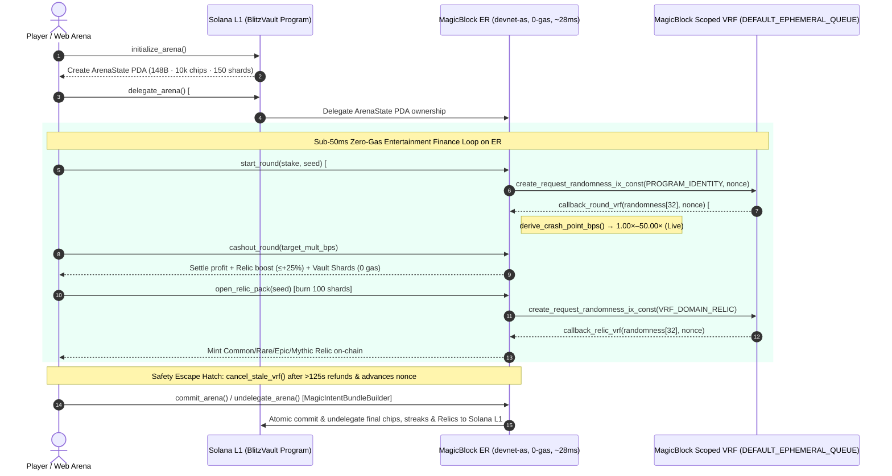

# ⚡ BlitzVault — Real-Time Entertainment Finance on MagicBlock ER

[](https://github.com/AndreyJackKali/blitz-vault/actions/workflows/ci-pages.yml)
[](https://github.com/AndreyJackKali/blitz-vault/actions/runs/45182964236)
[](https://andreyjackkali.github.io/blitz-vault/)
[](https://docs.magicblock.gg/)
[](https://www.anchor-lang.com/)

> **Built for Solana Blitz v10: Entertainment Finance** (Nov 20–27, 2026)  
> Zero-fee, sub-50ms on-chain **Crash Multiplier Arena** + **Provably Fair VRF Collectible Relic Packs** powered by **MagicBlock Ephemeral Rollups (`ephemeral-rollups-sdk 0.18.0`)** & **Scoped MagicBlock VRF**.

---

## 🎬 Live Demo & HD Walkthrough

- **Play Live Now (Zero Setup / Phantom Devnet + Judge Sandbox):** 👉 **[https://andreyjackkali.github.io/blitz-vault/](https://andreyjackkali.github.io/blitz-vault/)**
- **Watch 48s HD Walkthrough Video:** 👉 **[`docs/demo.mp4`](https://github.com/AndreyJackKali/blitz-vault/raw/main/docs/demo.mp4)** · **[GitHub Release `v1.0.0-blitz-v10`](https://github.com/AndreyJackKali/blitz-vault/releases/tag/v1.0.0-blitz-v10)**
- **Verified Green CI Proof (14 Rust Tests + 351 KB SBF ELF + 7/7 Localnet E2E):** 👉 **[GitHub Actions Run `#45182964236`](https://github.com/AndreyJackKali/blitz-vault/actions/runs/45182964236)**

[](https://andreyjackkali.github.io/blitz-vault/)

---

## Why Entertainment Finance Needs MagicBlock Ephemeral Rollups

Entertainment Finance merges **real-time speculation** and **collectible asset progression** on state players truly own. Standard Solana L1 execution (400ms slots + gas fees + wallet confirmation popups every move) breaks sub-second crash gameplay.

**BlitzVault** solves this with a 100% on-chain MagicBlock lifecycle and a self-reinforcing Entertainment Finance flywheel:

1. **Initialize on Solana L1 (`initialize_arena`):** Creates the player's canonical `ArenaState` PDA (`[b"blitz_arena_v1", player]`, 148 bytes) with `10,000` starter chips and `150` Vault Shards.
2. **Delegate to MagicBlock ER (`delegate_arena` via `#[delegate]`):** Delegates the `ArenaState` PDA via MagicBlock's Delegation Program ([`DELeGGvXpWV2fqJUhqcF5ZSYMS4JTLjteaAMARRSaeSh`](https://explorer.solana.com/address/DELeGGvXpWV2fqJUhqcF5ZSYMS4JTLjteaAMARRSaeSh?cluster=devnet)) to `devnet-as.magicblock.app` for **0-gas, sub-50ms execution**.
3. **Provably Fair Round Launch (`start_round` + `callback_round_vrf`):** Requests scoped randomness inside the ER via `create_request_randomness_ix_const` on the **fee-exempt `DEFAULT_EPHEMERAL_QUEUE`** ([`5hBR571xnXppuCPveTrctfTU7tJLSN94nq7kv7FRK5Tc`](https://explorer.solana.com/address/5hBR571xnXppuCPveTrctfTU7tJLSN94nq7kv7FRK5Tc?cluster=devnet)), verified by `#[vrf_callback]` to derive a heavy-tail crash multiplier (`1.00×–50.00×`).
4. **Sub-50ms Gasless Cashout (`cashout_round`):** Settles profit + permanent Relic yield boost (up to `+25%`) + streak-scaled Vault Shards (`25 + 10 × streak` on win, `+10` consolation on bust) inside the ER with **0 gas fees**.
5. **VRF Collectible Relic Packs (`open_relic_pack` + `callback_relic_vrf`):** Burns `100` Vault Shards for verifiable Relic drops (`Common 60% +1%`, `Rare 25% +3%`, `Epic 12% +6%`, `Mythic 3% +12%`, permanently boosting future crash profits up to `+25%`).
6. **Stale VRF Timeout Recovery (`cancel_stale_vrf`):** 125-second timeout safely refunds stake/shards and advances the round nonce so any delayed oracle callback fails closed.
7. **Atomic L1 Settlement (`commit_arena` & `undelegate_arena`):** Uses SDK `0.18.0`'s non-deprecated `MagicIntentBundleBuilder` to checkpoint or commit-and-undelegate final balances, win streaks, and Relic collections back to Solana L1.

---

## Architecture



---

## MagicBlock Primitives & Blitz v10 Judging Alignment

| MagicBlock Primitive / Criterion | Implementation in BlitzVault | Exact Source Code |
|---|---|---|
| **`#[ephemeral]` Program Architecture** | Full Ephemeral Rollup program entrypoint (`ephemeral-rollups-sdk = "=0.18.0"`, `anchor-lang = "1.0"`) | [`lib.rs#L32-L34`](programs/blitz-vault/src/lib.rs#L32-L34) |
| **Account Delegation (`#[delegate]`)** | `DelegateArena` (`UncheckedAccount` + `del` constraint, SIMD-0460 safe) delegating `ArenaState` PDA via `DELeGGvX…RSaeSh` | [`lib.rs#L72-L84`](programs/blitz-vault/src/lib.rs#L72-L84), [`L535-L543`](programs/blitz-vault/src/lib.rs#L535-L543) |
| **Scoped VRF Requests (`#[vrf]`)** | Domain-separated seeds (`VRF_DOMAIN_ROUND`, `VRF_DOMAIN_RELIC`), compile-time `PROGRAM_IDENTITY`, fee-exempt `DEFAULT_EPHEMERAL_QUEUE` (`5hBR57…FRK5Tc`) | [`lib.rs#L88-L145`](programs/blitz-vault/src/lib.rs#L88-L145), [`L243-L292`](programs/blitz-vault/src/lib.rs#L243-L292), [`L545-L568`](programs/blitz-vault/src/lib.rs#L545-L568) |
| **Verified VRF Callbacks (`#[vrf_callback]`)** | Scoped oracle verification + strict nonce/phase/kind guards preventing replay or cross-domain spoofing | [`lib.rs#L149-L176`](programs/blitz-vault/src/lib.rs#L149-L176), [`L296-L330`](programs/blitz-vault/src/lib.rs#L296-L330), [`L570-L575`](programs/blitz-vault/src/lib.rs#L570-L575) |
| **Atomic Commit & Undelegate (`#[commit]`)** | Zero deprecated APIs: `MagicIntentBundleBuilder` `.commit()` & `.commit_and_undelegate()` with pre-undelegate `arena.exit(&crate::ID)?` | [`lib.rs#L363-L389`](programs/blitz-vault/src/lib.rs#L363-L389), [`L590-L602`](programs/blitz-vault/src/lib.rs#L590-L602) |
| **Stale VRF Timeout Guard** | 125s TTL recovery (`cancel_stale_vrf`) refunds stake/shards and increments `round_nonce` so delayed callbacks fail closed | [`lib.rs#L334-L360`](programs/blitz-vault/src/lib.rs#L334-L360) |
| **Entertainment Finance Loop** | Sub-50ms crash multiplier speculation feeding streak-scaled Vault Shards into VRF Relic Pack collectibles (+1%..+12%, capped +25% yield boost) | [`lib.rs#L181-L240`](programs/blitz-vault/src/lib.rs#L181-L240), [`web/index.html`](web/index.html) |

---

## Verification, CI Proofs & On-Chain Status

| Check | Status | Details / Links |
|---|---|---|
| **CI Run `#45182964236`** | ✅ 3 / 3 Jobs Green | [View full GitHub Actions run (`84a6ef35`)](https://github.com/AndreyJackKali/blitz-vault/actions/runs/45182964236) — Rust Tests + SBF Build & Localnet E2E + GitHub Pages Deploy |
| **Solana SBF ELF Binary (`blitz_vault.so`)** | ✅ Built in CI | `351 KB` `ELF 64-bit LSB pie executable, eBPF` built via Agave `solana-cli 4.4.1` / `platform-tools v1.57` · SHA-256 `100ed23281ce1f40fa9d84ab741be22de9448262466ebda8fb2d3c7f80004697` ([Download CI Artifact](https://github.com/AndreyJackKali/blitz-vault/actions/runs/45182964236)) |
| **Extended Rust Unit & Invariant Suite** | ✅ 14 / 14 Passing | Crash curve bounds & 5k Monte Carlo distribution, VRF domain separation, Relic boost caps/overflow, payout solvency, Borsh `INIT_SPACE`, MagicBlock ER/VRF PDAs & instruction layouts |
| **Real `solana-test-validator` SBF E2E** | ✅ 7 / 7 On-Chain Assertions | Loads compiled `blitz_vault.so` into Solana BPF VM (`solana-core 4.4.1`), executes real `initialize_arena` (`20,041 CU`), verifies 148-byte on-chain `ArenaState` PDA, and proves all 6 negative security guards (`already in use`, `ConstraintSeeds 0x7d6`, `RoundNotLive 0x1775`, `NoPendingVrf 0x1779`, `StakeTooLow 0x1772`, `InvalidOracleQueue 0x1777`) |
| **Live Interactive Web Arena** | ✅ Live HTTPS | [andreyjackkali.github.io/blitz-vault](https://andreyjackkali.github.io/blitz-vault/) with live MagicBlock Devnet ER (`devnet-as.magicblock.app`) & Solana Devnet L1 RPC telemetry + click-to-verify VRF proof inspector |
| **MagicBlock Devnet Infrastructure** | ✅ Verified Live | Delegation Program [`DELeGGvX…RSaeSh`](https://explorer.solana.com/address/DELeGGvXpWV2fqJUhqcF5ZSYMS4JTLjteaAMARRSaeSh?cluster=devnet) · Ephemeral VRF Queue [`5hBR57…FRK5Tc`](https://explorer.solana.com/address/5hBR571xnXppuCPveTrctfTU7tJLSN94nq7kv7FRK5Tc?cluster=devnet) |
| **Solana Devnet Deploy Readiness** | ⚠️ Public RPC Faucet Closed (`410`) | Public `https://api.devnet.solana.com` `requestAirdrop` returns JSON-RPC `410` (*"The RPC faucet is closed on this cluster. Request test SOL at https://faucet.solana.com"*). Ready for 1-command deploy below once deployer wallet is funded with ~2.5 Devnet SOL. |

<details>
<summary><strong>📜 Verbatim Localnet SBF E2E Transaction Logs & Negative Guard Proofs (CI Run #45182964236)</strong></summary>

```text
=== BlitzVault SBF On-Chain E2E Validator Test ===
RPC: http://127.0.0.1:8899 Cluster version: {"feature-set":2681577653,"solana-core":"4.4.1"}
✅ Program loaded: BLzVt11111111111111111111111111111111111111 (executable=true)
✅ Funded test player  : 25zrW3pemUt2tyMGgAv1ehF6zNx7EFbticsDWTZKkKPk (5 SOL localnet)
✅ Funded test intruder: F8i2ekAZJoX5L8Esdfvh5zrtibXybPYqwaMe7Hruwwxa (5 SOL localnet)
Derived PDAs:
  ArenaState PDA      : DpHe7D3RKVk6hMRBdKj9LM7WGBAsqZdBL9ccdYxng18r (bump=251)
  VRF ProgramIdentity : 7QwesfRe7oNnnfaoxwGXpDj4kaNfWdyWXDEgNyYMe7Mb
  ER Buffer PDA       : FbgU1XxhR5USoySXAqGw15rw78Xz5AGtKXkQAyDZ9egX
  ER DelegationRecord : HmptST2HwTAFbGz6rdi5a3oJA3VRKwyYfPqMBekLfPUr
  ER DelegationMeta   : ASUBpV2rmfhKLpjB3Pki5Lbz4iwniqp5B2cU2Hh47HGm
✅ [PASS] initialize_arena confirmed: 37mHJQWcdH77dW3bSydw6ikhMjniWFQHRXtbMFpsS3o2DLJK8J2TDvyAHaSwycmmTaXcGdP3Lo32ssC2p1SA3tbc
   BPF Program Logs:
     Program BLzVt11111111111111111111111111111111111111 invoke [1]
     Program log: Instruction: InitializeArena
     Program 11111111111111111111111111111111 invoke [2]
     Program 11111111111111111111111111111111 success
     Program log: BlitzVault arena initialized for 25zrW3pemUt2tyMGgAv1ehF6zNx7EFbticsDWTZKkKPk with 10000 chips
     Program BLzVt11111111111111111111111111111111111111 consumed 20041 of 200000 compute units
     Program BLzVt11111111111111111111111111111111111111 success
✅ [PASS] On-chain ArenaState verified: 148 bytes, chips=10000, shards=150, phase=Idle
✅ [PASS] duplicate initialize_arena rejected cleanly on-chain (already in use)
✅ [PASS] unauthorized intruder cashout_round rejected cleanly on-chain (0x7d6 ConstraintSeeds)
✅ [PASS] cashout_round while Idle rejected cleanly on-chain (0x1775 RoundNotLive)
✅ [PASS] cancel_stale_vrf while Idle rejected cleanly on-chain (0x1779 NoPendingVrf)
✅ [PASS] start_round below MIN_STAKE rejected cleanly on-chain (0x1772 StakeTooLow)
✅ [PASS] start_round with invalid oracle queue rejected cleanly on-chain (0x1777 InvalidOracleQueue)
=== ALL 7 ON-CHAIN SBF E2E ASSERTIONS PASSED ===
```

</details>

---

## 1-Command Build, Test & Devnet Deploy

```bash
# 1. Run all 14 Rust unit & MagicBlock layout tests
cargo test --manifest-path programs/blitz-vault/Cargo.toml --lib -- --nocapture

# 2. Build the Solana SBF binary (target/deploy/blitz_vault.so)
cargo-build-sbf --manifest-path programs/blitz-vault/Cargo.toml --sbf-out-dir target/deploy

# 3. Run real localnet SBF E2E test against compiled blitz_vault.so (7/7 on-chain assertions)
solana-test-validator --reset --quiet \
  --bpf-program BLzVt11111111111111111111111111111111111111 target/deploy/blitz_vault.so \
  --bpf-program Vrf1RNUjXmQGjmQrQLvJHs9SNkvDJEsRVFPkfSQUwGz target/deploy/blitz_vault.so &
node scripts/e2e_localnet.mjs

# 4. Deploy to Solana Devnet (after funding wallet with ~2.5 SOL from https://faucet.solana.com)
solana program deploy target/deploy/blitz_vault.so --url devnet
```

---

## Technical Highlights (Nov 2026 MagicBlock Best Practices)
- **SDK `0.18.0` + Anchor `1.0.2`:** Compatible with both validator 1.x and 2.0 public ERs (avoids `0.20.0` `slot_hashes` VRF breakage).
- **Scoped VRF Security:** Compile-time `PROGRAM_IDENTITY = program_identity_pubkey(&crate::ID)` + `#[vrf_callback]` prevents spoofed oracle calls.
- **Strict Nonce State Machine:** `Idle → AwaitingVrf(nonce) → Live → Idle` with `cancel_stale_vrf()` (>125s TTL) advancing the nonce so late callbacks fail closed.
- **Zero Deprecated APIs:** Uses `MagicIntentBundleBuilder` and `UncheckedAccount` with `del` constraint (SIMD-0460 safe).
- **Exact Rust ↔ Frontend Parity:** Both `programs/blitz-vault/src/lib.rs` and `web/index.html` implement identical `derive_crash_point_bps(&[u8; 32])` fixed-point basis-point arithmetic.
